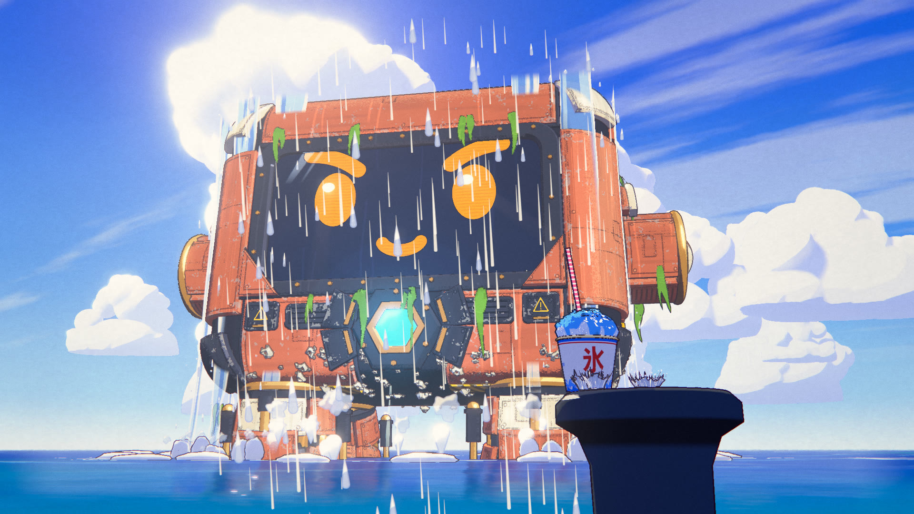
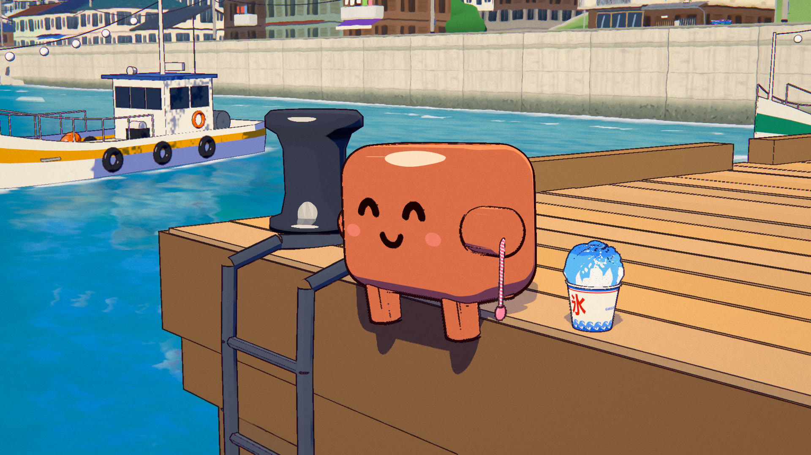
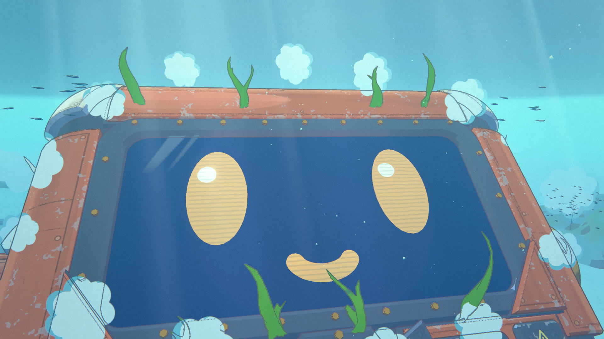
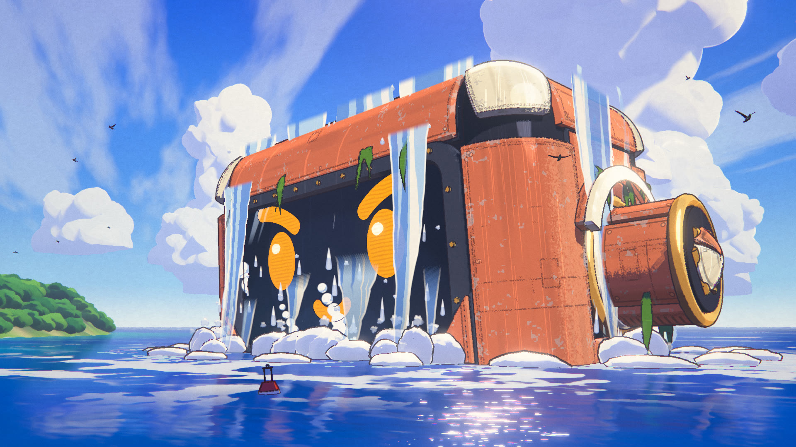
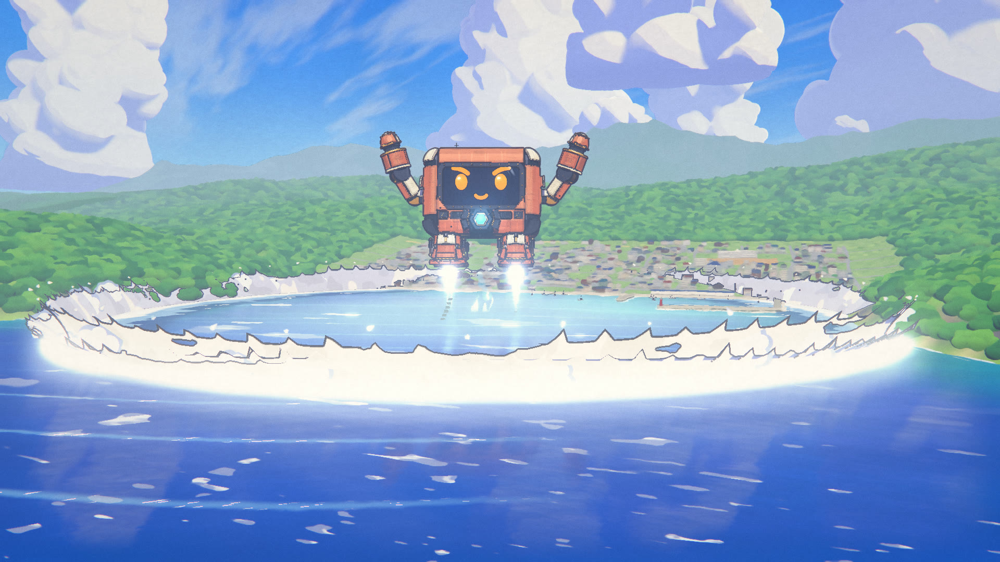
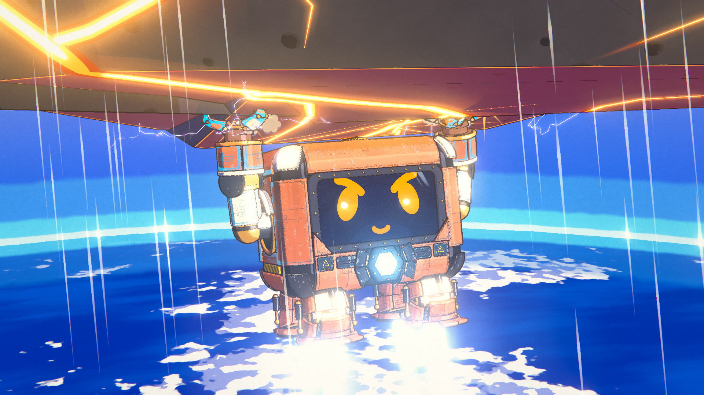
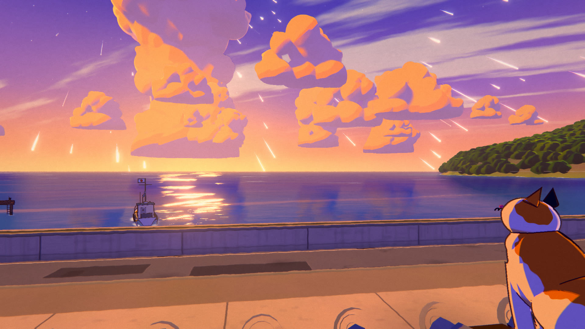

# MEGA CLAWD · 巨神

An 82-second anime short where every frame is rendered by code: no video model, no image model, no hand-drawn frames.



| | |
|---|---|
|  |  |
|  |  |
|  |  |

**Watch:** download `dist/megaclawd.html` (1080p) or `dist/megaclawd_lite.html` (960×540, for lighter GPUs) and open
it in any browser with a GPU. Each is one self-contained file (7 MB): the player renders the film live in
WebGL2 with the soundtrack inlined, and works offline. To get the MP4, render it yourself with `npm run build` (below).

> An original story and original designs, series **Fable 5.5 Anime Lab**. Made with Fable 5.5.
> The full prompt is in [PROMPT.md](PROMPT.md); how the agent teams were organised is in [docs/WORKFLOW.md](docs/WORKFLOW.md).

---

## The story

A blazing summer day in a small seaside town. Little Clawd is eating blue shaved ice at the end of the pier when a glint
in the syrup turns out to be a meteor falling straight at the town. He sets his cup down on a bollard, jumps into the
bay and wakes the colossal mecha sleeping on the sea floor, built in his own shape. MEGA CLAWD rises with the sea pouring
off its armour, leaps through the clouds to the edge of space, catches the burning meteor and bursts it into a shower of
shooting stars over the town at dusk. Back on the pier, soaked, Clawd finds his cup: the ice has melted into blue water.
He drinks it anyway.

## Why it looks like anime

The film is one three.js (r160, WebGL2) scene drawn through a custom multi-pass pipeline that imitates a cel +
painted-background production:

| Pass | What it does |
|---|---|
| shadow / reflection | character-only shadow map (painted lighting, not physics); mirrored camera for the sea |
| main (MRT) | colour + a data buffer (view normal, depth, material id: background / cel / FX) |
| paint | depth-aware anisotropic Kuwahara "brush" filter on background pixels only: gouache look, world-anchored paper |
| ink | hand-inked lines on cel pixels only: id / depth / normal edges, pressure noise, thickness by distance |
| water | the sea at kilometre scale: swell, whitecaps, glitter, foam lace, mirror reflections |
| atmosphere | height haze (aerial perspective), sea mist, light shafts |
| overlay | drawn energy, lightning and water FX, after paint + ink |
| bloom / grade | glow on emissives, high-key anime grade, lavender shadows / warm highs, impact flash, film grain |

* **Everything is 3D under the drawing.** Clawd is the project mascot (a sculpted vinyl-toy model with a library of
  facial expressions) shaded with two hard tones, a crisp highlight and cool lavender shadows. MEGA CLAWD is a 120 m
  giant in Clawd's silhouette: bevelled armour slabs grown on parametric surfaces, panel lines, bolts, vents, hazard
  stripes and wear drawn procedurally in the cel shader, a dark visor that shows the mascot's own faces as amber
  displays, a faceted blue reactor, and side nubs that telescope out into arms with three-finger clamp hands (IK onto
  the real surface of the meteor).
* **Dense painted world.** About 600 procedural houses with kawara roofs, telephone poles and sagging wires, a shrine
  on the hill, a harbour with fishing boats and lighthouses, a calico cat, gulls and a furin. Cumulus towers are
  ray-traced unions of spheres, so the giant can fly through them from any angle. The meteor is a knapped basalt
  polyhedron that breaks into Voronoi chunks with molten cores.
* **Animation is on twos and threes**, like film anime: characters at 12 drawings a second, water FX at 8, the camera
  on every frame. FX are drawn like FX cels (flat colour bands around white-hot cores), never particle mush.
* **Every frame is a pure function of time.** No `Math.random`, no carried state: frames render in any order, so the
  headless render is resumable, parallel and deterministic.
* **Sound is fully synthesized** with Web Audio `OfflineAudioContext`, no samples: an original orchestral score built on
  one summer motif in D major, plus ambience and effects locked to the story beats (`CUES` in `src/shots.js`), mastered
  in JS to -14 LUFS with a -2.5 dBTP true-peak ceiling.

Numbers: 36 shots, 1968 frames at 24 fps, 1920×1080. A frame takes about 0.32 s at 1080p on an RTX 2060 (PNG
included); two render processes in parallel finish the whole film in about 6 minutes. About 12,300 lines of
JavaScript (`src/` and `tools/`, three.js not counted).

## How it was made

One director session and 7 agent teams in Claude Code, working from a shared production bible
([CONTRACT.md](CONTRACT.md)). The engine team went first (pipeline, tools, module API, placeholders for everything).
Then six departments worked in parallel, each owning its own files and its shots' cameras: mecha, pilot (Clawd, the
shaved ice, the cockpit), world (town, sea, sky, Earth), meteor + energy FX, water (underwater bay, splashes, the wave)
and sound. Every picture department rendered stills of its shots and checked them against the art direction and the
collision / luma QC; sound checked its render-audio report (loudness per section, spectrum, cue onsets, R128) and the
`docs/team-sound.jpg` sheet. Fresh art-director agents that had not built the work reviewed every department (11
reviews, 10 fix rounds). The director then integrated everything and rendered a draft that a person watched and
approved; one last fix pass took the weakest reads, then the final was rendered. In all: 31 agents and about 8 hours of wall-clock time. Details:
[docs/WORKFLOW.md](docs/WORKFLOW.md), engine notes: [docs/ARCHITECTURE.md](docs/ARCHITECTURE.md).

## Shots

| Act | Time | Shots | What happens |
|---|---|---|---|
| Summer | 0–10 s | s01–s04 | the harbour town under towering cumulus, a cat asleep on hot tiles, Clawd and his blue shaved ice; a glint in the syrup |
| The meteor | 10–19.5 s | s05–s09 | a white streak, the meteor ignites over the planet's limb, gulls burst from the wires; Clawd sets down his cup and jumps |
| Awakening | 19.5–38 s | s10–s16 | the giant asleep on the sea floor, amber eyes, the cockpit, the reactor; the bay boils and MEGA CLAWD rises |
| Launch | 38–50 s | s17–s22 | the meteor splits the clouds, levers forward, the arms unfold, the leap, the climb to the curve of the Earth |
| The catch | 50–64 s | s23–s29 | near silence, impact, strain, red alarms, the reactor surge, cracks, the meteor bursts |
| Dusk | 64–78.5 s | s30–s35 | shooting stars over the town, the fall, splash-down, the wave on the seawall, a smile, the melted ice |
| Card | 78.5–82 s | s36 | "Fable 5.5" brush lettering + 寓話 seal, MEGA CLAWD 巨神 |

The full shot list with every beat is in [CONTRACT.md](CONTRACT.md) and `src/shots.js`.

## Run it

Requirements: Node 20+, a GPU with WebGL2 (the tools refuse a software renderer unless you pass `--allow-sw`),
`ffmpeg` + `ffprobe` on `PATH` (`FFMPEG=/path/to/ffmpeg` overrides ffmpeg; ffprobe must be on `PATH`). Chromium comes
with Playwright (or set `CHROME=/path/to/chrome`).

```bash
npm install
npx playwright install chromium
```

**Live.** Serve the folder with any static server and open `index.html` to scrub through the film:

```bash
npx serve .
# then open http://localhost:3000/?scale=1
```

| URL parameter | What |
|---|---|
| `?t=41.5` · `?f=300` · `?shot=s16` (`s16@0` first frame, `s16@1` last) | jump to a time, frame or shot |
| `?scale=1` | full 1920×1080 (default `2` = 960×540, `4` = 480×270) |
| `?play=1` | start playing |
| `?cam=x,y,z&at=x,y,z&fov=40` | free debug camera |
| `?look={json}` | override any look knob (see `BASE_LOOK` in `src/pipeline.js`) |
| `?debug=id\|depth\|normal\|mask\|raw` | show a pipeline buffer |
| `?groups=coast,sky` · `?labels=1` · `?mecha=0` · `?grain=0` | force set groups, show labels, skip a department, no grain |

Keys: space play / pause · ←/→ one frame · shift+←/→ one second · `[` `]` previous / next shot · H hide the bar · F
fullscreen.

**Stills.** Render any frame headless at full resolution (shot middle, `@0` / `@1` first / last frame, a time, a frame,
every shot, or a free camera). They are written to `WORK/snap/` (see below), or to `--out <dir>`:

```bash
node tools/snap.mjs --scale 1 s:s16 s:s24@0 t:41.2 f:300
node tools/snap.mjs --scale 2 all3 --sheet all3
node tools/snap.mjs --scale 1 "q:cam=0,60,300&at=0,60,0&fov=35&t=45=name:mycam"
```

**Full build.** Soundtrack, film (resumable PNG frames), the single-file players in `dist/`, the MP4:

```bash
npm run build
```

`npm run build` = `tools/render-audio.mjs` → `tools/render.mjs` → `tools/build-player.mjs` → `tools/encode.mjs`. Work files
(frames, WAV, MP4) go to `WORK` = `%LOCALAPPDATA%\Temp\cmv-32\<team>` on Windows, `./WORK/<team>` elsewhere, or
`MC_WORK` (the default team is `engine`). The players land in `dist/`; the MP4 lands in `WORK/megaclawd.mp4`, not in
the repo (`node tools/encode.mjs --out <name>` renames it). The render is resumable and can run in several terminals
at once (each takes the chunks the others have not locked): `node tools/render.mjs --order reverse` in a second
terminal. Then check every rendered frame: `node tools/check.mjs --frames frames`.

| Tool | What |
|---|---|
| `tools/snap.mjs` | stills by shot / time / frame / free camera, `--sheet` contact sheet, `--measure` Clawd's hue |
| `tools/render.mjs` | film frames → PNG in chunks of 96, resumable, any order, parallel (`--from --to --step 4 --order shuffle`) |
| `tools/render-audio.mjs` | `audio.html` → `soundtrack.wav` + `.m4a`, loudness / spectrum / cue report, EBU R128 re-check |
| `tools/encode.mjs` | frames + WAV → H.264 High, yuv420p, BT.709, 24 fps CFR, AAC 192k, faststart (`--crf 16`) |
| `tools/build-player.mjs` | `dist/megaclawd.html` (1080p) + `dist/megaclawd_lite.html` (960×540): every module, asset and the soundtrack inlined |
| `tools/check.mjs` | QC: page errors, collisions of registered solids, luma jumps > 25 tv levels, blank and frozen frames (`--only s15,s16`, `--frames frames`) |
| `tools/sheet.mjs` | contact sheet of a folder |
| `tools/lookdev.mjs` | one still per set through the pipeline → `docs/engine-lookdev.jpg` |

## Layout

```
index.html           live scrub page (import map -> vendor/three, no CDN)
audio.html           renders the soundtrack (used by tools/render-audio.mjs)
CONTRACT.md          the production bible: story, designs, art direction, shots, ownership, quality gates
PROMPT.md            the full prompt
LICENSE              MIT
docs/                ARCHITECTURE.md (engine notes), WORKFLOW.md (how the teams worked), stills/, contact sheets
src/shots.js         the 36 shots and the story beats (CUES): one clock for picture, sound and QC
src/main.js          engine entry: boot, module API, frame loop, headless API
src/ui.js            the live scrub bar + keys (also in the player)
src/pipeline*.js     the anime pipeline: passes, cel / paint materials, painted-set kit, collisions
src/cams/            cameras and looks for each department's shots
src/mecha*.js        MEGA CLAWD: rig + IK, armour construction, paint, visor face, kelp / water / steam / trails
src/pilot*.js        little Clawd, the shaved ice and the spoon; src/cockpit*.js the cockpit, its screens and the view
src/world*.js        terrain, town, the hero house, harbour + pier + boats, the cat / gulls / furin / laundry
src/ocean.js         the sea; src/sky*.js skies, cumulus, the stratosphere and the Earth
src/meteor*.js       the meteor; src/fx-energy*.js plasma, thrusters, shockwaves, lightning, shooting stars
src/under.js         the underwater bay; src/fx-water*.js splash, sheets, plume, the wave, spray
src/audio*.js        the synthesized score, sound design, synth kit, mastering + analysis
src/assets/clawd/    the mascot model + emotion library
tools/               snap, render, render-audio, encode, build-player, check, sheet, lookdev
player/player.html   the single-file player template
dist/                the built single-file players
vendor/three/        three.js r160 (only the files the film imports, MIT)
```

## License

MIT © 2026 seeconever, see [LICENSE](LICENSE). three.js is MIT (`vendor/three/LICENSE`).
Series: Fable 5.5 Anime Lab.
